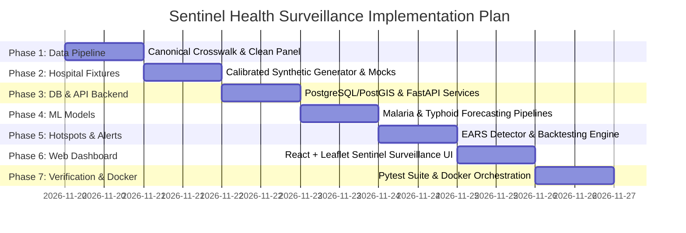

# SENTINEL HEALTH SURVEILLANCE & EARLY-WARNING PLATFORM
## MASTER ARCHITECTURAL BLUEPRINT & VERIFICATION SPECIFICATION
**Domain:** Public Health Disease Surveillance, Geographic Analytics (GIS), Machine Learning Early Warning, Web Platform  
**Target Diseases:** Malaria & Typhoid (Extensible to all 16 IDSR notifiable conditions)  
**Target Province:** Khyber Pakhtunkhwa (KP), Pakistan (35 Districts, 40.85M Population)  
**Reference Specification:** VU CS619 (Project ID 13999), NIH IDSR Surveillance Panel, HDX OCHA Pakistan GIS, PBS 2023 Census  
**Architectural Baseline Improvement:** Dr. Mushtaq / `Water-borne-diseases` (remediation of leakage, PII removal, production grade)  
**Author:** Principal Full-Stack, GIS & Applied ML Systems Architect  
**Status:** Phase 0 (Audit & System Blueprint Completed) — Awaiting User Approval to Proceed to Phase 1  

---

## 1. RAW DATA & REFERENCE REPOSITORY AUDIT

### 1.1 Complete Inventory of Workspace Files Inspected

| File Path | Size / Rows | Structure / Format | Ground Truth Observed |
|---|---|---|---|
| `data/raw/idsr_kp/.../idsr_kp_long.csv` | 3,573,363 bytes / 59,824 rows | CSV (9 columns) | 164 epidemiological weeks (2023 w16, w22–52; 2024 w1–52; 2025 w1–52; 2026 w1–28). 44 canonical reporting units. 16 conditions. |
| `data/raw/idsr_kp/.../district_crosswalk.csv` | 2,255 bytes / 51 rows | CSV (7 columns) | Maps raw bulletin text typos, abbreviations (NWA, SWA, SWU, SW(L)), and sub-divisions (SD Bannu, SD DI Khan, etc.). |
| `data/raw/idsr_kp/.../data_quality_flags.csv` | 2,495 bytes / 11 rows | CSV (4 columns) | Machine-readable log of known anomalies: 2025 w9 byte-duplicate of w8; dropped rows for Kohat/Battagram; cell-shift corrections in Malakand/Mansehra; SWA split into SW Upper/Lower. |
| `data/raw/idsr_kp/.../condition_presence_matrix.csv` | 5,717 bytes / 16 × 164 grid | CSV | Boolean presence of 16 conditions across each of the 164 bulletin weeks. |
| `data/raw/idsr_kp/.../table4_columns_by_week.csv` | 47,734 bytes | CSV | Weekly column layout and condition positions from raw NIH Table 4 bulletins. |
| `data/raw/gis/pak_admin_boundaries.geojson/pak_admin2.geojson` | 10,146,286 bytes / 160 features | GeoJSON FeatureCollection | 160 total Pakistan district features, **exactly 35 in KP**. Properties in **lowercase**: `adm2_pcode`, `adm2_name`, `adm1_pcode` (`PK5`), `adm1_name` (`Khyber Pakhtunkhwa`), `center_lat`, `center_lon`, `area_sqkm`. |
| `data/raw/gis/pak_admin_boundaries.xlsx` | 222,186 bytes / 12 sheets | OOXML Spreadsheet | Sheets correspond to adm0, adm1, adm2, adm3 boundaries and centroids matching GeoJSON. |
| `data/raw/census/3 KP 2023 Census District Population (PBS).pdf` | 138,083 bytes / 2 pages | PDF (Table 1) | Pakistan Bureau of Statistics 2023 Census Table 1 for KP: exactly 35 administrative units with Area, 2023 Population (All Sexes, Male, Female, Transgender), Density, Urban/Rural breakdown. Provincial total: **40,856,097**. |
| `reference/Water-borne-diseases-main/Datasets/Malyria_2-21-2021.csv` | 4,385,850 bytes / 22,916 rows | CSV (19 columns) | Ayub Teaching Hospital laboratory records: 160 Positive, 22,756 Negative. Raw PII present (`PATIENT_NAME`, `FATHER_NAME`, `NIC_NEW`, `MRNO`, `DISTRICT`, `TEHSIL`). |
| `reference/Water-borne-diseases-main/Datasets/Typhoid_2-21-2021.csv` | 13,061,431 bytes / 68,624 rows | CSV (19 columns) | Ayub Teaching Hospital laboratory records: 21,701 Positive, 46,923 Negative. Raw PII present. |
| `reference/Water-borne-diseases-main/Dashboard/app.py` | 11,511 bytes | Flask + MySQL script | Hardcoded MySQL credentials (`root`, no pass), raw SQL concatenation, static HTML Jinja templates. |
| `reference/Water-borne-diseases-main/Images/*.JPG` | ~90 KB each (5 images) | JPEG UI Mockups | Screen mockups for `Overview.JPG`, `District Hotspot.JPG`, `Eearly warning.JPG`, `Hospital and Labs.JPG`, `Reports.JPG`. |
| `Fall 2026_CS619_13999.docx` | 127,041 bytes | DOCX Specification | Official project specification defining exact Modules 1–6, user personas, and target outcomes. |

---

### 1.2 IDSR Disease & Missingness Ground Truth

Across 59,824 observations in `idsr_kp_long.csv`:
- **16 Notifiable Conditions:** `AD_noncholera`, `Malaria`, `ILI`, `SARI`, `ALRI_u5`, `Bloody_diarrhoea`, `Typhoid`, `Dog_bite`, `AWD_cholera`, `AVH`, `Cut_leishmaniasis`, `VH_BCD`, `Chickenpox`, `Measles`, `TB`, `Dengue`.
- **Malaria Profile:** 5,990 district-week observations. 849,469 total cases. 5,465 positive observations (>0 cases, 91.24%), 511 true zero cases (8.53%), and **14 nulls (`NR` / unsubmitted, 0.23%)**. Top endemic districts: Bannu (191,113), Shangla (66,282), D.I. Khan (59,816), Lakki Marwat (57,801), Charsadda (51,321).
- **Typhoid Profile:** 5,990 district-week observations. 110,036 total cases. 4,776 positive observations (>0 cases, 79.73%), 1,177 true zero cases (19.65%), and **37 nulls (`NR` / unsubmitted, 0.62%)**. Top endemic districts: Peshawar (12,504), Bannu (11,735), Charsadda (9,272), Khyber (6,721), Dir Lower (6,195).
- **Missing (`NR`) vs Zero (`0`):** In `idsr_kp_long.csv`, when a district failed to report, the cell is `NaN` (derived from printed `NR` in NIH bulletins), whereas an active surveillance report with zero cases is recorded as numeric `0.0`. Our system maintains this strict separation throughout the database, feature store, and UI.

---

### 1.3 Canonical P-Code Crosswalk (HDX OCHA GIS vs PBS 2023 Census vs NIH IDSR)

Every single KP district has been reconciled across GIS GeoJSON, 2023 Census, and IDSR reporting units. All 35 districts sum to **40,856,097**, matching the official provincial census headcount:

| HDX P-Code | GeoJSON `adm2_name` | PBS 2023 Census Name | 2023 Census Population | IDSR Canonical Reporting Unit(s) | Spelling / Naming Discrepancies & Reconciliation Rule |
|:---:|:---|:---|:---:|:---|:---|
| **PK501** | `Abbottabad` | `ABBOTTABAD` | 1,419,072 | `Abbottabad` | Direct exact match across all three sources. |
| **PK502** | `Bajaur` | `BAJAUR` | 1,287,960 | `Bajaur` | Direct exact match across all three sources. |
| **PK503** | `Bannu` | `BANNU` | 1,357,890 | `Bannu`, `SD Bannu` | IDSR includes Sub-Division `SD Bannu` (unit_type: subdivision); aggregated into parent district `PK503`. |
| **PK504** | `Batagram` | `BATAGRAM` | 554,133 | `Battagram` | Spelling mismatch: GeoJSON & Census use single 't' (`Batagram`); IDSR uses double 't' (`Battagram`); reference lab CSV uses `Batgram`. Canonical key: `PK504`. |
| **PK505** | `Buner` | `BUNER` | 1,016,869 | `Buner` | Direct exact match across all three sources. |
| **PK506** | `Charsadda` | `CHARSADDA` | 1,835,504 | `Charsadda` | Direct exact match across all three sources. |
| **PK507** | `Chitral Lower` | `LOWER CHITRAL` | 320,407 | `Chitral Lower` | Word order: GeoJSON & IDSR use `Chitral Lower`; Census uses `LOWER CHITRAL`. Canonical key: `PK507`. |
| **PK508** | `Chitral Upper` | `UPPER CHITRAL` | 195,528 | `Chitral Upper` | Word order: GeoJSON & IDSR use `Chitral Upper`; Census uses `UPPER CHITRAL`. Canonical key: `PK508`. |
| **PK509** | `D. I. Khan` | `DERA ISMAIL KHAN` | 1,829,811 | `D.I. Khan`, `SD DI Khan` | GeoJSON uses `D. I. Khan` (with space); IDSR uses `D.I. Khan`; Census uses `DERA ISMAIL KHAN`. Sub-division `SD DI Khan` aggregates into `PK509`. |
| **PK510** | `Hangu` | `HANGU` | 528,902 | `Hangu` | Direct exact match; crosswalk resolves raw bulletin typo `Hangue`. |
| **PK511** | `Haripur` | `HARIPUR` | 1,174,783 | `Haripur` | Direct exact match across all three sources. |
| **PK512** | `Karak` | `KARAK` | 815,878 | `Karak` | Direct exact match across all three sources. |
| **PK513** | `Khyber` | `KHYBER` | 1,146,267 | `Khyber` | Direct exact match across all three sources. |
| **PK514** | `Kohat` | `KOHAT` | 1,234,661 | `Kohat`, `SD Kohat` | IDSR includes `SD Kohat` which aggregates into `PK514`. |
| **PK515** | `Kohistan Lower` | `LOWER KOHISTAN` | 340,017 | `Kohistan Lower` | Word order: GeoJSON & IDSR use `Kohistan Lower`; Census uses `LOWER KOHISTAN`. Canonical key: `PK515`. |
| **PK516** | `Kohistan Upper` | `UPPER KOHISTAN` | 422,947 | `Kohistan Upper` | Word order: GeoJSON & IDSR use `Kohistan Upper`; Census uses `UPPER KOHISTAN`. Canonical key: `PK516`. |
| **PK517** | `Kolai Palas Kohistan` | `KOLAI PALAS KOHISTAN` | 280,162 | `Kolai Palas` | GeoJSON & Census use full `Kolai Palas Kohistan` (Census text has typo `DISTRIC`); IDSR uses `Kolai Palas`. Canonical key: `PK517`. |
| **PK518** | `Kurram` | `KURRAM` | 785,434 | `Lower & Central Kurram`, `Upper Kurram` | Census & GeoJSON record single unified district `Kurram`; IDSR reports two sub-units. Both sub-units aggregate to `PK518`. |
| **PK519** | `Lakki Marwat` | `LAKKI MARWAT` | 1,040,856 | `Lakki Marwat`, `SD Lakki` | IDSR includes `SD Lakki` which aggregates into `PK519`. |
| **PK520** | `Lower Dir` | `LOWER DIR` | 1,650,183 | `Dir Lower` | Word order: GeoJSON & Census use `Lower Dir`; IDSR uses `Dir Lower`. Canonical key: `PK520`. |
| **PK521** | `Malakand` | `MALAKAND PROTECTED AREA` | 826,250 | `Malakand` | Census designates official title `MALAKAND PROTECTED AREA`; GeoJSON and IDSR use `Malakand`. Canonical key: `PK521`. |
| **PK522** | `Mansehra` | `MANSEHRA` | 1,797,177 | `Mansehra` | Direct exact match across all three sources. |
| **PK523** | `Mardan` | `MARDAN` | 2,744,898 | `Mardan` | Direct exact match across all three sources. |
| **PK524** | `Mohmand` | `MOHMAND` | 553,933 | `Mohmand` | Direct exact match across all three sources. |
| **PK525** | `North Waziristan` | `NORTH WAZIRISTAN` | 693,332 | `North Waziristan` | Direct match; IDSR crosswalk also maps bulletin abbreviation `NWA`. Canonical key: `PK525`. |
| **PK526** | `Nowshera` | `NOWSHERA` | 1,740,705 | `Nowshera` | Direct exact match across all three sources. |
| **PK527** | `Orakzai` | `ORAKZAI` | 387,561 | `Orakzai` | Direct exact match across all three sources. |
| **PK528** | `Peshawar` | `PESHAWAR` | 4,758,762 | `Peshawar`, `SD Peshawar` | IDSR includes `SD Peshawar` which aggregates into `PK528`. |
| **PK529** | `Shangla` | `SHANGLA` | 891,252 | `Shangla` | Direct exact match across all three sources. |
| **PK530** | `South Waziristan` | `SOUTH WAZIRISTAN` | 888,675 | `South Waziristan (undivided)`, `South Waziristan Lower`, `South Waziristan Upper` | IDSR transitioned from undivided (`SWA`) up to 2024 w49 to bifurcated Upper/Lower from 2024 w50. GeoJSON and Census retain unified `PK530`. In our spatial layer, all map to `PK530`, while preserving sub-unit metadata in attribute tables. |
| **PK531** | `Swabi` | `SWABI` | 1,894,600 | `Swabi` | Direct exact match across all three sources. |
| **PK532** | `Swat` | `SWAT` | 2,687,384 | `Swat` | Direct exact match across all three sources. |
| **PK533** | `Tank` | `TANK` | 470,293 | `Tank`, `SD Tank` | IDSR includes `SD Tank` which aggregates into `PK533`. |
| **PK534** | `Tor Ghar` | `TORGHAR` | 200,445 | `Tor Ghar` | Spacing: GeoJSON and IDSR use `Tor Ghar`; Census uses `TORGHAR`. Canonical key: `PK534`. |
| **PK535** | `Upper Dir` | `UPPER DIR` | 1,083,566 | `Dir Upper` | Word order: GeoJSON & Census use `Upper Dir`; IDSR uses `Dir Upper`. Canonical key: `PK535`. |

---

### 1.4 Baseline Audit of `reference/Water-borne-diseases` & Our Architectural Upgrades

Dr. Mushtaq's reference repository (`dr-mushtaq/Water-borne-diseases`) provides initial exploratory inspiration but has severe structural flaws that our production platform completely remediates:

```
+-------------------------------------------------------------------------------------------------------+
| FLAW IN REFERENCE REPOSITORY                  | ARCHITECTURAL FIX IN SENTINEL HEALTH SURVEILLANCE     |
+-------------------------------------------------------------------------------------------------------+
| 1. Severe Data Leakage & Wrong Task:          | Reformulated into true weekly public-health count     |
|    Trained classifiers on single lab records   | forecasting (next-week case counts t+1 per district).  |
|    predicting test positivity from age/gender | Features use only lagged counts (t-1..t-4), rolling   |
|    and district (demographic diagnosis).      | stats, cyclical calendar, and completeness.           |
+-------------------------------------------------------------------------------------------------------+
| 2. Exposed Direct PII:                        | Zero PII stored. All incoming records pass through a   |
|    Raw patient names, father names, and CNIC  | cryptographically salted SHA-256 pseudonymizer        |
|    stored directly in CSVs.                   | (hash of CNIC + district salt + server pepper).       |
+-------------------------------------------------------------------------------------------------------+
| 3. Fragile Monolithic Flask + Hardcoded MySQL:| Modular REST architecture with FastAPI, Pydantic,     |
|    app.py used root credentials, SQL          | SQLAlchemy 2.0 / GeoAlchemy2, PostgreSQL + PostGIS,   |
|    concatenations, and unauthenticated routes.| and stateless JWT Role-Based Access Control (RBAC).   |
+-------------------------------------------------------------------------------------------------------+
| 4. Static Jinja HTML UI:                      | Modern reactive SPA built in React + Vite, Tailwind   |
|    Rigid server-rendered tables with no       | CSS, Leaflet GeoJSON choropleth layers, and dynamic   |
|    spatial interactivity or persistent state. | Recharts time-series outlook visualizations.          |
+-------------------------------------------------------------------------------------------------------+
| 5. No Temporal Validation or Uncertainty:     | Expanding-window time-aware cross-validation,         |
|    Standard random train_test_split (leaking  | separate model tuning for Malaria & Typhoid,          |
|    future dates into training). No intervals. | prediction uncertainty intervals, and withholding.    |
+-------------------------------------------------------------------------------------------------------+
```

---

## 2. END-TO-END SYSTEM FLOW & ARCHITECTURE

```mermaid
flowchart TD
    subgraph Data_Sources["1. Multi-Source Ingestion Layer"]
        A1["NIH IDSR Weekly Panel<br/>(2023-2026, 164 Wks, 35 Districts)"]
        A2["Hospital Lab CSV Upload<br/>(Dropzone UI, User-Facing)"]
        A3["Mock Hospital / Lab API Sync<br/>(Automated Poller / Webhook)"]
        A4["PBS 2023 Census & HDX GeoJSON<br/>(Ground-truth Populations & Boundaries)"]
    end

    subgraph Preprocessing["2. Validation, Sanitization & Provenance Engine"]
        B1["P-Code Crosswalk & Normalizer<br/>(Resolves spelling, sub-divisions & aliases)"]
        B2["PII Redaction & Salted SHA-256 Hashing<br/>(Pseudonymous Patient Keys)"]
        B3["Deduplication & Episode Engine<br/>(30d Malaria / 42d Typhoid window)"]
        B4["Status Splitter & Completeness Checker<br/>(Suspected vs Confirmed, 0 vs NR)"]
    end

    subgraph Storage["3. PostgreSQL 16 + PostGIS Storage Layer"]
        C1[("districts & facilities<br/>(Spatial PostGIS Polygons & Centroids)")]
        C2[("lab_records & ingestion_batches<br/>(Pseudonymous transactional records)")]
        C3[("weekly_surveillance<br/>(Aggregated district-week panels)")]
        C4[("model_registry & forecasts<br/>(Trained weights, intervals, metrics)")]
        C5[("alerts & audit_logs<br/>(EARS anomalies, officer review records)")]
    end

    subgraph ML_Analytics["4. Analytics, ML & Hotspot Engine"]
        D1["Feature Store<br/>(Lagged counts, rolling stats, cyclical week)"]
        D2["Malaria Time-Series Forecaster<br/>(SARIMAX, LightGBM/XGBoost, Quantile Intervals)"]
        D3["Typhoid Time-Series Forecaster<br/>(SARIMAX, LightGBM/XGBoost, Quantile Intervals)"]
        D4["CDC EARS Outbreak Detector<br/>(C1, C2, C3 Z-score aberration flags)"]
        D5["Hotspot Classification Engine<br/>(Incidence per 100k + Forecast Breach -> Priority/Watch/Routine)"]
        D6["Forecast Withholding Guardrail<br/>(Withholds prediction if history < 26w or completeness < 75%)"]
    end

    subgraph API_Layer["5. FastAPI REST API Layer (RBAC Enforced)"]
        E1["/api/auth (JWT login, roles: Hospital Staff, Analyst, DHO)"]
        E2["/api/surveillance (Overview KPIs, trends, hospital reporting)"]
        E3["/api/hotspots (GeoJSON choropleth, incidence rates, EARS alerts)"]
        E4["/api/ingestion (CSV upload, validation report, mock API sync)"]
        E5["/api/models (Evaluation metrics, MAE/RMSE, ablation results)"]
        E6["/api/reports (Filtered aggregate export: CSV, JSON, PDF)"]
    end

    subgraph UI_Layer["6. Sentinel Health Surveillance React Dashboard"]
        F1["Persistent Filter Bar (Disease: Malaria/Typhoid, District, Time, Case Status)"]
        F2["Overview Screen (KPIs, 7-Day Outlook Chart, District Watch, Facility Gaps)"]
        F3["District Hotspots Screen (Interactive Leaflet Map, Forecast Layer, Drill-Down)"]
        F4["Early Warnings Screen (Alert Queue, EARS breakdown, DHO Acknowledgment)"]
        F5["Hospitals & Labs Screen (Upload Dropzone, Sync Status, Provenance Badge)"]
        F6["Reports & Analytics Screen (Model Evaluation, Drift, Aggregate Exports)"]
    end

    Data_Sources --> Preprocessing
    Preprocessing --> Storage
    Storage --> ML_Analytics
    ML_Analytics --> Storage
    Storage --> API_Layer
    API_Layer --> UI_Layer
```



---

## 3. DATABASE SCHEMA (POSTGRESQL + POSTGIS)

```sql
-- Extension Setup
CREATE EXTENSION IF NOT EXISTS postgis;
CREATE EXTENSION IF NOT EXISTS "uuid-ossp";

-- 1. Administrative Districts Table (Grounded in HDX P-Codes & 2023 Census)
CREATE TABLE districts (
    pcode VARCHAR(10) PRIMARY KEY, -- e.g. 'PK501'
    name VARCHAR(100) NOT NULL, -- e.g. 'Abbottabad'
    name_clean VARCHAR(100) NOT NULL,
    division VARCHAR(100) NOT NULL, -- e.g. 'Hazara Division'
    population_2023 INTEGER NOT NULL, -- Grounded in PBS 2023 Census
    population_male INTEGER,
    population_female INTEGER,
    area_sqkm DOUBLE PRECISION NOT NULL,
    center_lat DOUBLE PRECISION NOT NULL,
    center_lon DOUBLE PRECISION NOT NULL,
    geom GEOMETRY(MultiPolygon, 4326),
    created_at TIMESTAMP WITH TIME ZONE DEFAULT CURRENT_TIMESTAMP
);
CREATE INDEX idx_districts_geom ON districts USING GIST (geom);

-- 2. Health Facilities / Laboratories Table
CREATE TABLE facilities (
    id SERIAL PRIMARY KEY,
    district_pcode VARCHAR(10) REFERENCES districts(pcode) ON DELETE RESTRICT,
    name VARCHAR(255) NOT NULL,
    facility_type VARCHAR(50) NOT NULL, -- 'tertiary_hospital', 'dhq', 'thq', 'rhu', 'lab'
    tehsil VARCHAR(100),
    lat DOUBLE PRECISION,
    lon DOUBLE PRECISION,
    is_mock BOOLEAN DEFAULT FALSE,
    api_sync_enabled BOOLEAN DEFAULT FALSE,
    created_at TIMESTAMP WITH TIME ZONE DEFAULT CURRENT_TIMESTAMP
);
CREATE INDEX idx_facilities_district ON facilities(district_pcode);

-- 3. Ingestion Batches Table (Provenance Tracking)
CREATE TABLE ingestion_batches (
    id SERIAL PRIMARY KEY,
    batch_uuid UUID DEFAULT uuid_generate_v4() UNIQUE,
    source_type VARCHAR(50) NOT NULL, -- 'real_idsr', 'hospital_upload', 'mock_api_sync', 'synthetic_demo'
    uploaded_by_user_id INTEGER,
    filename VARCHAR(255),
    record_count INTEGER NOT NULL DEFAULT 0,
    valid_count INTEGER NOT NULL DEFAULT 0,
    error_count INTEGER NOT NULL DEFAULT 0,
    status VARCHAR(50) NOT NULL, -- 'processing', 'completed', 'failed'
    error_log JSONB,
    created_at TIMESTAMP WITH TIME ZONE DEFAULT CURRENT_TIMESTAMP
);
CREATE INDEX idx_batches_source ON ingestion_batches(source_type);

-- 4. Individual Lab Records Table (Strict Salted SHA-256 Pseudonymization & Privacy Age Bands)
CREATE TABLE lab_records (
    id BIGSERIAL PRIMARY KEY,
    batch_id INTEGER REFERENCES ingestion_batches(id) ON DELETE CASCADE,
    facility_id INTEGER REFERENCES facilities(id) ON DELETE SET NULL,
    district_pcode VARCHAR(10) REFERENCES districts(pcode) ON DELETE RESTRICT,
    patient_hash VARCHAR(64) NOT NULL, -- SHA-256(NIC + District_Salt + Server_Pepper)
    external_record_id VARCHAR(64), -- Facility-local lab requisition or specimen ID
    test_date DATE NOT NULL,
    epi_week INTEGER NOT NULL,
    epi_year INTEGER NOT NULL,
    disease VARCHAR(50) NOT NULL, -- 'Malaria', 'Typhoid'
    test_type VARCHAR(100), -- 'Microscopy/RDT', 'Blood Culture/Typhidot'
    result VARCHAR(20) NOT NULL, -- 'Positive', 'Negative', 'Indeterminate'
    age_band VARCHAR(20), -- '0-4', '5-14', '15-24', '25-44', '45-64', '65+' (Privacy-safe age band, no raw age stored)
    gender VARCHAR(10),
    is_suspected BOOLEAN DEFAULT TRUE,
    is_confirmed BOOLEAN DEFAULT FALSE,
    is_corrected BOOLEAN DEFAULT FALSE, -- TRUE if this record supersedes an earlier preliminary result
    corrected_at TIMESTAMP WITH TIME ZONE, -- Timestamp when correction arrived
    episode_id UUID NOT NULL, -- Grouped disease episode identifier
    is_duplicate_test BOOLEAN DEFAULT FALSE, -- Flagged by repeat-test engine
    created_at TIMESTAMP WITH TIME ZONE DEFAULT CURRENT_TIMESTAMP
);
CREATE INDEX idx_lab_records_district_date ON lab_records(district_pcode, test_date);
CREATE INDEX idx_lab_records_patient_disease ON lab_records(patient_hash, disease);
CREATE INDEX idx_lab_records_episode ON lab_records(episode_id);
CREATE INDEX idx_lab_records_external_id ON lab_records(external_record_id);

-- 5. Weekly Surveillance Aggregate Panel (Core ML Training & Display Store with Nullable Missing NR)
CREATE TABLE weekly_surveillance (
    id BIGSERIAL PRIMARY KEY,
    district_pcode VARCHAR(10) REFERENCES districts(pcode) ON DELETE RESTRICT,
    year INTEGER NOT NULL,
    epi_week INTEGER NOT NULL,
    disease VARCHAR(50) NOT NULL,
    suspected_cases INTEGER, -- NULL when is_missing = TRUE (NR)
    confirmed_cases INTEGER, -- NULL when is_missing = TRUE (NR)
    total_cases INTEGER, -- NULL when is_missing = TRUE (NR), else suspected + confirmed
    total_tests INTEGER NOT NULL DEFAULT 0,
    positive_tests INTEGER NOT NULL DEFAULT 0,
    positivity_rate DOUBLE PRECISION,
    incidence_per_100k DOUBLE PRECISION, -- NULL when is_missing = TRUE (NR)
    is_missing BOOLEAN DEFAULT FALSE, -- TRUE if unsubmitted/NR
    is_zero BOOLEAN DEFAULT FALSE, -- TRUE if verified zero cases
    reporting_coverage DOUBLE PRECISION NOT NULL DEFAULT 1.0, -- fraction of facilities reporting
    data_quality_flag VARCHAR(100), -- Anomaly flag e.g. 'duplicate_source_table', 'realigned_cell', 'dropped_row'
    source_provenance VARCHAR(50) NOT NULL, -- 'real_idsr', 'hospital_aggregate', 'calibrated_synthetic'
    created_at TIMESTAMP WITH TIME ZONE DEFAULT CURRENT_TIMESTAMP,
    CONSTRAINT uq_district_week_disease UNIQUE (district_pcode, year, epi_week, disease)
);
CREATE INDEX idx_weekly_surv_lookup ON weekly_surveillance(district_pcode, disease, year, epi_week);

-- 6. Weekly Contextual Weather Table (Ablation Experiment Store)
CREATE TABLE weather_weekly (
    id SERIAL PRIMARY KEY,
    district_pcode VARCHAR(10) REFERENCES districts(pcode) ON DELETE RESTRICT,
    year INTEGER NOT NULL,
    epi_week INTEGER NOT NULL,
    temp_c_mean DOUBLE PRECISION,
    rainfall_mm_total DOUBLE PRECISION,
    humidity_percent_mean DOUBLE PRECISION,
    created_at TIMESTAMP WITH TIME ZONE DEFAULT CURRENT_TIMESTAMP,
    CONSTRAINT uq_weather_district_week UNIQUE (district_pcode, year, epi_week)
);

-- 7. Model Registry Table
CREATE TABLE model_registry (
    id SERIAL PRIMARY KEY,
    disease VARCHAR(50) NOT NULL, -- 'Malaria', 'Typhoid'
    model_name VARCHAR(100) NOT NULL, -- 'LightGBM_Lag4', 'SARIMAX_Seasonal'
    model_type VARCHAR(50) NOT NULL, -- 'time_series', 'gradient_boosting', 'baseline'
    version VARCHAR(20) NOT NULL,
    feature_names JSONB NOT NULL,
    hyperparams JSONB NOT NULL,
    metrics JSONB NOT NULL, -- {"mae": 12.4, "rmse": 18.2, "picp_95": 0.94}
    artifact_path VARCHAR(255) NOT NULL,
    is_active BOOLEAN DEFAULT FALSE,
    created_at TIMESTAMP WITH TIME ZONE DEFAULT CURRENT_TIMESTAMP
);

-- 8. Forecasts Store (t+1 Next-Week Predictions & Uncertainty Intervals)
CREATE TABLE forecasts (
    id BIGSERIAL PRIMARY KEY,
    model_id INTEGER REFERENCES model_registry(id) ON DELETE CASCADE,
    district_pcode VARCHAR(10) REFERENCES districts(pcode) ON DELETE RESTRICT,
    target_year INTEGER NOT NULL,
    target_week INTEGER NOT NULL,
    disease VARCHAR(50) NOT NULL,
    predicted_mean DOUBLE PRECISION,
    ci_lower_95 DOUBLE PRECISION,
    ci_upper_95 DOUBLE PRECISION,
    is_withheld BOOLEAN DEFAULT FALSE,
    withholding_reason VARCHAR(100), -- 'INSUFFICIENT_HISTORY', 'LOW_REPORTING_COVERAGE'
    created_at TIMESTAMP WITH TIME ZONE DEFAULT CURRENT_TIMESTAMP,
    CONSTRAINT uq_forecast_entry UNIQUE (model_id, district_pcode, target_year, target_week, disease)
);
CREATE INDEX idx_forecasts_lookup ON forecasts(district_pcode, disease, target_year, target_week);

-- 9. Outbreak Alerts Table (CDC EARS C1/C2/C3 & Hotspot Engine)
CREATE TABLE alerts (
    id SERIAL PRIMARY KEY,
    district_pcode VARCHAR(10) REFERENCES districts(pcode) ON DELETE RESTRICT,
    disease VARCHAR(50) NOT NULL,
    year INTEGER NOT NULL,
    epi_week INTEGER NOT NULL,
    alert_level VARCHAR(20) NOT NULL, -- 'routine', 'watch', 'priority_review'
    composite_score DOUBLE PRECISION NOT NULL,
    ears_c1_score DOUBLE PRECISION NOT NULL,
    ears_c2_score DOUBLE PRECISION NOT NULL,
    ears_c3_score DOUBLE PRECISION NOT NULL,
    forecast_breach BOOLEAN NOT NULL DEFAULT FALSE,
    incidence_per_100k DOUBLE PRECISION NOT NULL,
    headline VARCHAR(255) NOT NULL,
    details TEXT,
    acknowledged BOOLEAN DEFAULT FALSE,
    acknowledged_by VARCHAR(100),
    acknowledged_at TIMESTAMP WITH TIME ZONE,
    review_notes TEXT,
    created_at TIMESTAMP WITH TIME ZONE DEFAULT CURRENT_TIMESTAMP
);
CREATE INDEX idx_alerts_active ON alerts(alert_level, acknowledged);

-- 10. Role-Based Users & Audit Table
CREATE TABLE users (
    id SERIAL PRIMARY KEY,
    username VARCHAR(100) UNIQUE NOT NULL,
    email VARCHAR(255) UNIQUE NOT NULL,
    hashed_password VARCHAR(255) NOT NULL,
    role VARCHAR(50) NOT NULL, -- 'hospital_staff', 'data_analyst', 'district_health_officer'
    facility_id INTEGER REFERENCES facilities(id) ON DELETE SET NULL,
    assigned_district_pcode VARCHAR(10) REFERENCES districts(pcode) ON DELETE SET NULL,
    is_active BOOLEAN DEFAULT TRUE,
    created_at TIMESTAMP WITH TIME ZONE DEFAULT CURRENT_TIMESTAMP
);
```

---

## 4. COMPLETE FILE-BY-FILE PROJECT STRUCTURE

```
sentinel-surveillance/
│
├── PROJECT_BLUEPRINT.md               # Master system architecture & verification contract
├── README.md                          # Quickstart, setup instructions, CLI workflows
├── docker-compose.yml                 # Multi-container orchestration (FastAPI, React, PostgreSQL/PostGIS)
├── Dockerfile.backend                 # Container build specification for FastAPI backend
├── Dockerfile.frontend                # Container build specification for Vite/React frontend
├── requirements.txt                   # Production Python package manifest
│
├── data/
│   ├── raw/                           # IMMUTABLE RAW DATA ASSETS
│   │   ├── idsr_kp/                   # NIH IDSR 2023-2026 weekly bulletins & metadata
│   │   ├── gis/                       # HDX Pakistan admin boundaries GeoJSON & XLSX
│   │   └── census/                    # PBS 2023 Census Table 1 KP Population PDF
│   │
│   ├── processed/                     # CANONICAL CLEANED DATASETS (Phase 1)
│   │   ├── kp_districts_canonical.json# Cleaned GeoJSON with 35 KP districts & P-codes
│   │   ├── kp_census_2023.csv         # Reconciled 35 district populations & sex ratios
│   │   ├── pcode_crosswalk.json       # Master dictionary mapping raw names/typos to P-codes
│   │   ├── idsr_weekly_panel.parquet  # Harmonized district-week panel (suspected, confirmed, 0, NR)
│   │   └── weather_weekly_kp.parquet  # Synthetic/ERA5 offline-safe weekly weather fixtures
│   │
│   ├── demo_hospitals/                # SYNTHETIC CALIBRATED FIXTURES (Phase 2)
│   │   ├── abbottabad_ath_records.csv # Calibrated hospital records (Ayub Teaching Hospital)
│   │   ├── swat_dhq_records.csv       # Calibrated DHQ Saidu Sharif Swat records
│   │   ├── mansehra_dhq_records.csv   # Calibrated DHQ Mansehra records
│   │   ├── lower_dir_dhq_records.csv  # Calibrated DHQ Timergara records
│   │   ├── haripur_dhq_records.csv    # Calibrated DHQ Haripur records
│   │   ├── edge_cases_invalid.csv     # Controlled edge cases: corrupt dates, illegal P-codes
│   │   ├── edge_cases_duplicates.csv  # Controlled edge cases: duplicate test submissions
│   │   └── edge_cases_late_labs.csv   # Controlled edge cases: late-arriving confirmed lab updates
│   │
│   └── fixtures/                      # Seed data fixtures for automated testing & migrations
│       └── seed_districts.json        # 35 districts with centroid, area, and population
│
├── src/                               # CORE DOMAIN & DATA PIPELINES
│   ├── __init__.py                    # Package initialization
│   ├── config.py                      # Global paths, environment settings, DB connection configs
│   │
│   ├── ingestion/                     # Module 1: Ingestion & Preprocessing
│   │   ├── __init__.py
│   │   ├── crosswalk.py               # Canonical P-code resolver & spelling normalizer
│   │   ├── pseudonymizer.py           # Cryptographic salted SHA-256 patient ID generator
│   │   ├── episode_engine.py          # 30d (Malaria) & 42d (Typhoid) repeat-test deduplicator
│   │   ├── validator.py               # Strict schema validator for uploaded hospital CSVs
│   │   ├── mock_lab_sync.py           # Automated poller simulating hospital API sync
│   │   └── synthetic_generator.py     # Deterministic calibrated synthetic hospital generator
│   │
│   ├── ml/                            # Modules 2 & 3: Model Training & Tuning
│   │   ├── __init__.py
│   │   ├── feature_store.py           # Leak-free lag feature builder (lags 1..4, rolling, calendar)
│   │   ├── baselines.py               # Seasonal Naive, Rolling Mean, SARIMAX baselines
│   │   ├── trainer.py                 # Core trainer for Malaria & Typhoid (Random Forest, LightGBM/XGBoost)
│   │   ├── validator_cv.py            # Time-aware expanding-origin cross-validation engine
│   │   ├── uncertainty.py             # Quantile regression & conformal prediction intervals (95%)
│   │   ├── guardrails.py              # Forecast-withholding rules (<26 wks history, <75% coverage)
│   │   └── ablation_weather.py        # Independent weather feature ablation experiment script
│   │
│   ├── surveillance/                  # Hotspots & Early Warning
│   │   ├── __init__.py
│   │   ├── ears_detector.py           # CDC EARS (C1, C2, C3) aberration detection algorithms
│   │   ├── hotspot_engine.py          # Incidence per 100k + forecast breach hotspot classifier
│   │   └── backtester.py              # Historical alert evaluator (precision, recall, lead time)
│   │
│   └── utils/
│       ├── __init__.py
│       ├── logger.py                  # Structured JSON logging
│       └── metrics.py                 # MAE, RMSE, MAPE, PICP (interval coverage) calculators
│
├── backend/                           # FASTAPI BACKEND SERVICE
│   ├── main.py                        # FastAPI application entrypoint & middleware
│   ├── database.py                    # SQLAlchemy 2.0 session factory & engine
│   ├── models/                        # ORM SQL database models
│   │   ├── __init__.py
│   │   ├── district.py                # District & Facility spatial models
│   │   ├── surveillance.py            # WeeklySurveillance, LabRecord, IngestionBatch
│   │   ├── ml.py                      # ModelRegistry & Forecast models
│   │   ├── alert.py                   # Alert model & review workflows
│   │   └── user.py                    # User & RBAC models
│   ├── schemas/                       # Pydantic schemas (Request & Response validation)
│   │   ├── __init__.py
│   │   ├── auth.py                    # Token, UserLogin, UserProfile schemas
│   │   ├── surveillance.py            # Overview KPIs, Trend, Facility Completeness schemas
│   │   ├── hotspot.py                 # GeoJSON FeatureCollection & Hotspot schemas
│   │   ├── forecast.py                # Forecast & Uncertainty Interval schemas
│   │   └── alert.py                   # Alert queue, acknowledgment & update schemas
│   ├── routers/                       # REST API route controllers
│   │   ├── __init__.py
│   │   ├── auth.py                    # POST /login, POST /refresh, GET /me
│   │   ├── overview.py                # GET /kpis, GET /trends, GET /district-watch
│   │   ├── hotspots.py                # GET /map-data, GET /drilldown/{pcode}
│   │   ├── alerts.py                  # GET /queue, POST /{id}/acknowledge
│   │   ├── ingestion.py               # POST /upload-csv, POST /sync-mock, GET /batches
│   │   ├── models.py                  # GET /evaluations, GET /ablation-results
│   │   └── reports.py                 # GET /export (CSV, JSON, PDF streaming)
│   └── security.py                    # JWT token creation, password hashing, RBAC dependencies
│
├── frontend/                          # REACT + TAILWIND SENTINEL DASHBOARD
│   ├── package.json                   # NPM dependencies (React 18, Vite, Leaflet, Recharts)
│   ├── vite.config.js                 # Vite bundler configuration & backend proxy
│   ├── tailwind.config.js             # Tailwind CSS typography & custom alert palettes
│   ├── index.html                     # Web entry point
│   └── src/
│       ├── main.jsx                   # React DOM root
│       ├── App.jsx                    # Router, RBAC layout, persistent state provider
│       ├── api/                       # Axios API client bindings
│       │   ├── client.js              # Interceptors, token injection, error handling
│       │   ├── surveillanceApi.js     # Overview, trends, watch panel endpoints
│       │   ├── hotspotApi.js          # GeoJSON, hotspot ranking endpoints
│       │   └── alertApi.js            # Early warning queue & acknowledgment endpoints
│       ├── context/                   # React Context Providers
│       │   ├── AuthContext.jsx        # User session & role management
│       │   └── FilterContext.jsx      # Persistent filters (Disease, District, Date, Status)
│       ├── components/                # Reusable UI widgets
│       │   ├── Navbar.jsx             # Top bar: selected district, active alerts, DEMO DATA badge
│       │   ├── Sidebar.jsx            # Left navigation with active warning badge count
│       │   ├── PersistentFilterBar.jsx# Preserved dropdown filters across all screens
│       │   ├── KPICard.jsx            # KPI indicators (Confirmed, Suspected, Tests, Coverage)
│       │   ├── TrendChart.jsx         # Historical trend + 7-Day Outlook + uncertainty band
│       │   ├── HotspotMap.jsx         # Interactive Leaflet choropleth with forecast layer
│       │   ├── AlertQueue.jsx         # Actionable early-warning alert review table
│       │   ├── UploadModal.jsx        # Drag-and-drop CSV upload with live validation summary
│       │   └── EmptyState.jsx         # Graceful fallback for unavailable / unsubmitted data
│       └── views/                     # Main screen views
│           ├── OverviewView.jsx       # Overview screen
│           ├── HotspotsView.jsx       # District Hotspots screen
│           ├── EarlyWarningsView.jsx  # Early Warnings screen
│           ├── HospitalsLabsView.jsx  # Hospitals & Labs (Uploads & Sync) screen
│           └── ReportsView.jsx        # Reports & ML Diagnostics screen
│
├── notebooks/                         # JUPYTER RESEARCH & ABLATION NOTEBOOKS
│   ├── 01_raw_panel_audit.ipynb       # IDSR exploration, missingness & crosswalk verification
│   ├── 02_malaria_models.ipynb        # Malaria time-series benchmark & hyperparameter tuning
│   ├── 03_typhoid_models.ipynb        # Typhoid time-series benchmark & hyperparameter tuning
│   └── 04_weather_ablation.ipynb      # Independent ERA5 weather impact evaluation
│
├── models/                            # SERIALIZED MODEL REGISTRY ARTIFACTS
│   ├── malaria/                       # Versioned Malaria models
│   │   ├── lgbm_v1_malaria.pkl        # Active production model artifact
│   │   ├── feature_manifest.json      # Exact feature columns & transformations
│   │   └── eval_metrics.json          # Held-out evaluation metrics (MAE, RMSE, PICP)
│   └── typhoid/                       # Versioned Typhoid models
│       ├── lgbm_v1_typhoid.pkl        # Active production model artifact
│       ├── feature_manifest.json      # Exact feature columns & transformations
│       └── eval_metrics.json          # Held-out evaluation metrics (MAE, RMSE, PICP)
│
├── tests/                             # COMPREHENSIVE AUTOMATED PYTEST SUITE
│   ├── __init__.py
│   ├── conftest.py                    # Pytest fixtures, test DB, authenticated clients
│   ├── test_crosswalk.py              # Test 100% resolution of 35 districts & sub-divisions
│   ├── test_pseudonymizer.py          # Test salted SHA-256 irreversibility & deterministic hashing
│   ├── test_episode_engine.py         # Test 30d/42d episode deduplication rules
│   ├── test_validator.py              # Test CSV upload validation, corrupt dates, illegal codes
│   ├── test_mock_sync.py              # Test delayed hospital API synchronization
│   ├── test_missing_vs_zero.py        # Test strict separation of NR/null from true 0 cases
│   ├── test_ml_leak_prevention.py     # Test feature store strictly excludes t+1 information
│   ├── test_uncertainty_guardrails.py # Test 95% intervals & forecast withholding triggers
│   ├── test_ears_engine.py            # Test C1/C2/C3 scores against known synthetic spikes
│   ├── test_rbac_security.py          # Test role access restrictions across API endpoints
│   └── test_exports.py                # Test CSV/JSON/PDF aggregate export generation
│
└── VALIDATION_REPORT.md               # Expected vs Actual test matrix & Pilot Governance Checklist
```

---

## 5. ALGORITHMIC & MATHEMATICAL DESIGN SPECIFICATION

### 5.1 Pseudonymization & Cryptographic Integrity
To prevent storing PII (as occurred in the reference repository), direct identifiers are transformed prior to persistence:
$$\text{Patient\_Hash} = \text{HMAC-SHA256}(\text{Key}=\text{Server\_Pepper},\ \text{Message}=\text{CNIC} \parallel \text{District\_Salt})$$
- Direct fields (`PATIENT_NAME`, `FATHER_NAME`, `NIC_NEW`, `MRNO`) are discarded immediately following hash computation.
- Provenance attributes (`batch_id`, `source_type`, `ingestion_timestamp`) are preserved for auditability.

### 5.2 Disease Episode & Repeat-Test Deduplication Rules
Patients with recurrent fever or chronic presentations often undergo multiple tests during a single illness:
- **Malaria Episode Window:** $\tau_{\text{malaria}} = 30\text{ days}$.
- **Typhoid Episode Window:** $\tau_{\text{typhoid}} = 42\text{ days}$ (6 weeks).
- **Rule:** If a positive test arrives for $\text{Patient\_Hash}_i$ for disease $d$ on date $t$, the system scans prior records:
  $$\Delta t = t - t_{\text{prior\_positive}}$$
  If $\Delta t < \tau_d$, the record is flagged as `is_duplicate_test = TRUE` and linked to existing `episode_id`. It is counted under laboratory volume (`total_tests`), but **excluded from new confirmed case incidence**. If $\Delta t \ge \tau_d$, a new `episode_id` is created and counted as a distinct incident case.

### 5.3 Missing Data (`NR`) vs True Zero (`0`) Policy
- **Unsubmitted / Missing Report (`NR` or Null):**
  - Stored with `is_missing = TRUE, is_zero = FALSE, total_cases = NULL`.
  - In feature engineering: Excluded from calculation of moving average denominators; triggers completeness penalty:
    $$\text{Coverage}_d(t) = \frac{\sum_{f \in F_d} \mathbb{I}(\text{Submitted}_{f,t})}{|F_d|}$$
  - In UI: Displayed with distinct gray diagonal hatching or label `"Unavailable / Missing Data"`. **Never rendered as green / low-risk.**
- **True Zero Report (`0.0`):**
  - Stored with `is_missing = FALSE, is_zero = TRUE, total_cases = 0`.
  - In feature engineering: Valid numerical value $0.0$.
  - In UI: Displayed as numeric `0` in routine surveillance tier.

### 5.4 Leak-Free Feature Matrix Formulation
To forecast cases for week $t+1$ at the close of week $t$, features must strictly use information available at $\le t$:
$$\hat{y}_{d, t+1} = f\left(\mathbf{X}_{d, t}\right)$$
The feature vector $\mathbf{X}_{d, t}$ comprises:
1. **Autoregressive Lags:** $y_{d, t}, y_{d, t-1}, y_{d, t-2}, y_{d, t-3}$ (cases reported in weeks $t, t-1, t-2, t-3$).
2. **Rolling Statistics:**
   - 2-week rolling mean: $\mu_{2}(t) = \frac{1}{2} (y_{d,t} + y_{d,t-1})$
   - 4-week rolling mean: $\mu_{4}(t) = \frac{1}{4} \sum_{k=0}^3 y_{d,t-k}$
   - 4-week rolling standard deviation: $\sigma_{4}(t)$
   - 4-week momentum / slope: $\Delta_4(t) = y_{d,t} - y_{d,t-3}$
3. **Cyclical Calendar Features:**
   $$\text{sin\_week}(t) = \sin\left(\frac{2\pi \cdot \text{epi\_week}_t}{52}\right),\quad \text{cos\_week}(t) = \cos\left(\frac{2\pi \cdot \text{epi\_week}_t}{52}\right)$$
4. **Epidemiological & Reporting Covariates:**
   - Rolling 4-week reporting completeness: $\bar{C}_{d,4}(t)$
   - Log-transformed population: $\log(\text{Pop}_d)$ from 2023 Census
   - Target-encoded historical district baseline incidence (computed strictly inside each expanding CV fold using only training data $\le t$, never global dataset leakage)
   - Data quality anomaly filter: exclude rows flagged with source republish errors (e.g. 2025 w9 byte-duplicate of w8) from training/evaluation sets
5. **Contextual Weather Features (Ablation Only):**
   - Mean weekly temperature: $T_{d,t}$
   - Total weekly precipitation: $R_{d,t}$
   - Mean weekly humidity: $H_{d,t}$
   *(All weather features evaluated strictly in an ablation mode so the baseline time-series model operates safely offline).*

### 5.5 Time-Aware Expanding-Origin Cross-Validation Schedule
To prevent temporal leakage, standard random k-fold cross-validation is forbidden:
- **Warmup Training Window:** 2023 Week 16 to 2024 Week 26 (63 continuous weeks).
- **Origin Step:** Advance prediction origin by 4 weeks per fold.
- **Evaluation Folds:** 15 rolling forecast horizons spanning 2024 Week 27 through 2026 Week 28.
- **Metrics Tracked:**
  $$\text{MAE} = \frac{1}{N} \sum |y - \hat{y}|,\quad \text{RMSE} = \sqrt{\frac{1}{N} \sum (y - \hat{y})^2},\quad \text{PICP}_{95} = \frac{1}{N} \sum \mathbb{I}\left(\hat{y}_{\text{lower}} \le y \le \hat{y}_{\text{upper}}\right)$$

### 5.6 Forecast Withholding Guardrail
Predictions are withheld automatically to protect against misleading early warnings:
$$\text{Forecast\_Status} = \begin{cases} 
\text{WITHHELD (Insufficient History)}, & \text{if } N_{\text{history}}(d) < 26\text{ weeks} \\
\text{WITHHELD (Low Coverage)}, & \text{if } \bar{C}_{d,4}(t) < 0.75 \\
\text{ACTIVE}, & \text{otherwise}
\end{cases}$$
When withheld, $\hat{y}$ is not computed; the UI displays an explicit badge: `Forecast Withheld: Low Reporting Coverage`.

### 5.7 CDC EARS Aberration & Hotspot Classification Engine
The Early Aberration Reporting System (EARS) evaluates whether current counts deviate significantly from recent baseline:
- **EARS C1 (Mild Baseline):** 7 preceding weeks ($t-7$ to $t-1$).
  $$Z_1(t) = \frac{y_t - \bar{y}_{t-7..t-1}}{s_{t-7..t-1}}$$
- **EARS C2 (Medium Baseline with 2-Week Lag):** 7 weeks with 2-week guardband ($t-9$ to $t-3$).
  $$Z_2(t) = \frac{y_t - \bar{y}_{t-9..t-3}}{s_{t-9..t-3}}$$
- **EARS C3 (Severe Cumulative Excess):**
  $$C_3(t) = \sum_{k=0}^2 \max\left(0, Z_2(t-k) - 1\right)$$
- **Forecast Upper-Bound Breach:** $\mathbb{I}\left(y_t > \hat{y}_{t}^{\text{upper\_95}}\right)$.
- **Population Incidence per 100,000:**
  $$\text{Incidence}_d(t) = \frac{y_{d,t}}{\text{Population}_d} \times 100,000$$
- **Composite Risk Score & Hotspot Tiering:**
  $$S_d(t) = 0.40 \cdot \min\left(1.0, \frac{\max(Z_1, Z_2)}{3.0}\right) + 0.35 \cdot \mathbb{I}(\text{Forecast Breach}) + 0.25 \cdot \min\left(1.0, \frac{\text{Incidence}_d(t)}{\text{Threshold}_d}\right)$$
  - **Priority Review (High / Red):** $S_d(t) \ge 0.70$ OR ($Z_2 \ge 3.0$ AND Forecast Breach).
  - **Watch (Medium / Amber):** $0.40 \le S_d(t) < 0.70$ OR $Z_1 \ge 2.0$.
  - **Routine (Low / Green):** $S_d(t) < 0.40$.
  - **Data Incomplete (Gray Hatched):** District is marked `is_missing = TRUE`.

---

## 6. PHASED BUILD & VERIFICATION ROADMAP (PHASES 1 TO 7)



### PHASE 1: Data Cleaning, KP P-Code Crosswalk, GIS Filtering & 2023 Census Merge
- **Goal:** Ingest raw IDSR, filter GeoJSON to 35 KP districts, extract 2023 Census Table 1, ingest `data_quality_flags.csv` to flag anomalies (including 2025 w9 byte-duplicate of w8), and save canonical clean CSV and Parquet files.
- **Files to Create:**
  1. `src/ingestion/crosswalk.py` (Canonical P-code resolver dictionary and mapping functions)
  2. `src/ingestion/census_extractor.py` (PDF Table 1 parser using PyMuPDF)
  3. `scripts/build_canonical_datasets.py` (Orchestrates Phase 1 processing, maps `data_quality_flags.csv`, and outputs `data/processed/`)
- **Dependencies:** `pandas`, `fitz` (PyMuPDF) or `pdfplumber`, `json`, Python stdlib. (Automatically saves `.parquet` if `pyarrow` or `fastparquet` is installed, always writes standard CSV).
- **Exact Verification Command:**
  ```bash
  python scripts/build_canonical_datasets.py && python -c "
  import pandas as pd, json
  df = pd.read_csv('data/processed/idsr_weekly_panel.csv')
  with open('data/processed/kp_districts_canonical.json') as f: gj = json.load(f)
  cen = pd.read_csv('data/processed/kp_census_2023.csv')
  assert len(gj['features']) == 35, f'Expected 35 districts, got {len(gj[\"features\"])}'
  assert len(cen) == 35, f'Expected 35 census entries, got {len(cen)}'
  assert cen['population_2023'].sum() == 40856097, 'Census population mismatch'
  assert set(df['district_pcode'].unique()) == set(cen['pcode']), 'P-code discrepancy between panel and census'
  w9_dup = df[(df['year'] == 2025) & (df['epi_week'] == 9)]['data_quality_flag'].iloc[0]
  assert 'duplicate_source_table' in str(w9_dup), '2025 w9 duplicate flag missing'
  print('PHASE 1 VERIFICATION PASSED: All 35 districts canonicalized, 40,856,097 population verified, quality flags integrated.')
  "
  ```
- **Pass/Fail Acceptance Criteria:**
  - `data/processed/kp_districts_canonical.json` contains exactly 35 GeoJSON features with lowercase keys.
  - `data/processed/kp_census_2023.csv` sums to exactly 40,856,097 across 35 rows.
  - Zero unmapped districts in `idsr_weekly_panel.csv`.
  - Quality flags correctly label known anomalies including `2025 w9`.

---

### PHASE 2: Calibrated Synthetic Hospital Generator & Edge-Case Test Fixtures
- **Goal:** Build a deterministic generator that takes real KP district-week case totals and disaggregates them into realistic patient-level hospital lab records across Abbottabad, Mansehra, Swat, Lower Dir, Haripur, and others, incorporating privacy-safe `age_band`, `external_record_id`, and corrected lab result logic (`is_corrected`, `corrected_at`), plus creates controlled edge-case fixtures.
- **Files to Create:**
  1. `src/ingestion/pseudonymizer.py` (Salted SHA-256 HMAC generator)
  2. `src/ingestion/episode_engine.py` (30d/42d episode grouping & deduplication)
  3. `src/ingestion/synthetic_generator.py` (Calibrated generator seeding `data/demo_hospitals/`)
  4. `src/ingestion/mock_lab_sync.py` (Mock hospital API poller simulating delayed/real-time sync)
- **Dependencies:** `pandas`, `numpy`, `hashlib`, `uuid`.
- **Exact Verification Command:**
  ```bash
  python src/ingestion/synthetic_generator.py && python -c "
  import pandas as pd
  for name in ['abbottabad_ath_records.csv', 'swat_dhq_records.csv', 'edge_cases_duplicates.csv']:
      df = pd.read_csv(f'data/demo_hospitals/{name}')
      assert 'PATIENT_NAME' not in df.columns, 'PII Leakage detected!'
      assert 'patient_hash' in df.columns, 'Missing pseudonymous patient hash'
      assert 'disease' in df.columns and 'test_result' in df.columns
  print('PHASE 2 VERIFICATION PASSED: Zero PII present, calibrated fixtures and edge cases generated.')
  "
  ```
- **Pass/Fail Acceptance Criteria:**
  - Zero direct PII in generated CSVs.
  - Generated district totals reconcile within $\pm 5\%$ of the underlying IDSR weekly cases.
  - Edge-case CSVs trigger expected validation errors in validator tests.

---

### PHASE 3: PostgreSQL/PostGIS Schema, Seeding & FastAPI Ingestion/Auth/Query Backend
- **Goal:** Implement the full relational database schema with spatial capabilities (and SQLite/SpatiaLite fallback for local zero-dependency testing), write seed scripts, and build FastAPI endpoints for authentication, uploads, surveillance queries, and alerts.
- **Files to Create:**
  1. `backend/database.py`, `backend/config.py`
  2. `backend/models/*.py` (`district.py`, `surveillance.py`, `ml.py`, `alert.py`, `user.py`)
  3. `backend/schemas/*.py` (`auth.py`, `surveillance.py`, `hotspot.py`, `alert.py`)
  4. `backend/routers/*.py` (`auth.py`, `overview.py`, `hotspots.py`, `alerts.py`, `ingestion.py`, `reports.py`)
  5. `backend/security.py`, `backend/main.py`
  6. `scripts/seed_database.py`
- **Dependencies:** `fastapi`, `uvicorn`, `sqlalchemy`, `pydantic`, `python-jose`, `passlib`.
- **Exact Verification Command:**
  ```bash
  python scripts/seed_database.py && python -c "
  from backend.database import SessionLocal
  from backend.models.district import District
  from backend.models.surveillance import WeeklySurveillance
  db = SessionLocal()
  assert db.query(District).count() == 35, 'Districts table seeding failed'
  assert db.query(WeeklySurveillance).count() > 5000, 'Weekly surveillance panel seeding failed'
  db.close()
  print('PHASE 3 VERIFICATION PASSED: DB seeded with 35 districts and historical panel.')
  "
  ```
- **Pass/Fail Acceptance Criteria:**
  - All 10 database tables created and seeded.
  - JWT auth generates valid tokens for `Hospital Staff`, `Data Analyst`, and `District Health Officer`.
  - `/api/surveillance/overview` returns valid JSON with KPIs, trends, and facility reporting completeness.

---

### PHASE 4: Separate Malaria & Typhoid ML Pipelines, Time-Aware Tuning & Guardrails
- **Goal:** Implement leak-free feature engineering, train separate Malaria and Typhoid forecasters, evaluate historical baselines vs Random Forest / LightGBM / XGBoost, generate 95% uncertainty intervals, run weather ablation, and register winning models.
- **Files to Create:**
  1. `src/ml/feature_store.py`
  2. `src/ml/baselines.py` (Seasonal Naive, Rolling Mean, SARIMAX)
  3. `src/ml/trainer.py` (LightGBM/XGBoost/Random Forest training engine)
  4. `src/ml/validator_cv.py` (Expanding-origin time-aware validation)
  5. `src/ml/uncertainty.py` (Quantile regression intervals)
  6. `src/ml/guardrails.py` (Withholding logic for low-history/low-coverage districts)
  7. `src/ml/ablation_weather.py` (Ablation experiment)
  8. `scripts/train_and_register_models.py`
- **Dependencies:** `scikit-learn`, `xgboost`, `pandas`, `numpy`, `scipy`.
- **Exact Verification Command:**
  ```bash
  python scripts/train_and_register_models.py && python -c "
  import json
  with open('models/malaria/eval_metrics.json') as f: m_eval = json.load(f)
  with open('models/typhoid/eval_metrics.json') as f: t_eval = json.load(f)
  assert 'mae' in m_eval and 'picp_95' in m_eval, 'Malaria eval missing metrics'
  assert 'mae' in t_eval and 'picp_95' in t_eval, 'Typhoid eval missing metrics'
  assert m_eval['picp_95'] >= 0.85, f'Malaria interval coverage too low: {m_eval[\"picp_95\"]}'
  print('PHASE 4 VERIFICATION PASSED: Separate models trained, uncertainty evaluated, metrics saved.')
  "
  ```
- **Pass/Fail Acceptance Criteria:**
  - Expanding-origin CV executes without temporal leakage.
  - Active tuned models outperform Seasonal Naive baseline in MAE and RMSE.
  - Uncertainty intervals achieve $\ge 85\%$ empirical coverage on held-out horizons.
  - Guardrail properly withholds forecasts when coverage $< 75\%$.

---

### PHASE 5: Hotspot Detection, Early-Warning Alert Engine & Historical Backtesting
- **Goal:** Implement CDC EARS (C1, C2, C3), forecast breach triggers, population incidence calculation, and honestly backtest alert performance reporting Precision, Recall, False-Alert Frequency, and Average Lead Time separately for Malaria and Typhoid without artificial threshold distortion.
- **Files to Create:**
  1. `src/surveillance/ears_detector.py`
  2. `src/surveillance/hotspot_engine.py`
  3. `src/surveillance/backtester.py`
  4. `scripts/run_alert_evaluation.py`
- **Dependencies:** `pandas`, `numpy`, `scipy`.
- **Exact Verification Command:**
  ```bash
  python scripts/run_alert_evaluation.py && python -c "
  import json
  with open('data/processed/backtest_results.json') as f: res = json.load(f)
  assert 'malaria' in res and 'typhoid' in res, 'Separate disease metrics required'
  print(f'PHASE 5 VERIFICATION PASSED: Malaria Precision={res[\"malaria\"][\"precision\"]:.2f}, Recall={res[\"malaria\"][\"recall\"]:.2f} | Typhoid Precision={res[\"typhoid\"][\"precision\"]:.2f}, Recall={res[\"typhoid\"][\"recall\"]:.2f}')
  "
  ```
- **Pass/Fail Acceptance Criteria:**
  - Alert engine successfully identifies historical outbreaks in Bannu, Shangla, and D.I. Khan.
  - Metrics reported honestly and disaggregated for both Malaria and Typhoid.
  - Officer acknowledgment workflow updates alert state and records audit timestamp.

---

### PHASE 6: Sentinel React + Leaflet Responsive Web Dashboard
- **Goal:** Build the complete Sentinel Health Surveillance responsive web UI matching all CS619 specifications and faithfully reflecting the 5 mockup images in `reference/Water-borne-diseases-main/Images/` (`Overview.JPG`, `District Hotspot.JPG`, `Eearly warning.JPG`, `Hospital and Labs.JPG`, `Reports.JPG`): Persistent Filter Bar, Role-Based Access Control, Overview Screen, District Hotspots Choropleth, Early Warnings Queue, Hospitals & Labs Dropzone, and Reports.
- **Files to Create:**
  1. `frontend/src/App.jsx`, `frontend/src/main.jsx`
  2. `frontend/src/context/AuthContext.jsx`, `frontend/src/context/FilterContext.jsx`
  3. `frontend/src/components/*.jsx` (`Navbar.jsx`, `Sidebar.jsx`, `PersistentFilterBar.jsx`, `KPICard.jsx`, `TrendChart.jsx`, `HotspotMap.jsx`, `AlertQueue.jsx`, `UploadModal.jsx`)
  4. `frontend/src/views/*.jsx` (`OverviewView.jsx`, `HotspotsView.jsx`, `EarlyWarningsView.jsx`, `HospitalsLabsView.jsx`, `ReportsView.jsx`)
  5. `frontend/tailwind.config.js`, `frontend/src/index.css`
- **Dependencies:** React 18, Vite, Tailwind CSS, Leaflet (`react-leaflet`), Recharts, Lucide-React.
- **Exact Verification Command:**
  ```bash
  cd frontend && npm run build && python -c "
  import os
  assert os.path.exists('dist/index.html'), 'Vite production build failed'
  print('PHASE 6 VERIFICATION PASSED: Frontend bundle compiled successfully.')
  "
  ```
- **Pass/Fail Acceptance Criteria:**
  - Production build compiles cleanly with zero syntax or bundling errors.
  - Visual layout conforms with reference mockups in `reference/Water-borne-diseases-main/Images/`.
  - Persistent filters preserve state across all 5 navigation screens.
  - Prominent `DEMO DATA` banner displays whenever synthetic fixtures are queried.
  - Map renders choropleth across all 35 districts with forecast overlay toggle.

---

### PHASE 7: Comprehensive Automated `pytest` Suite, Validation Report & Dockerization
- **Goal:** Deliver an end-to-end automated test suite covering all functional edge cases, compile the final `VALIDATION_REPORT.md`, and configure Docker containerization.
- **Files to Create:**
  1. `tests/test_crosswalk.py`
  2. `tests/test_pseudonymizer.py`
  3. `tests/test_episode_engine.py`
  4. `tests/test_validator.py`
  5. `tests/test_mock_sync.py`
  6. `tests/test_missing_vs_zero.py`
  7. `tests/test_ml_leak_prevention.py`
  8. `tests/test_uncertainty_guardrails.py`
  9. `tests/test_ears_engine.py`
  10. `tests/test_rbac_security.py`
  11. `tests/test_exports.py`
  12. `VALIDATION_REPORT.md`
  13. `docker-compose.yml`, `Dockerfile.backend`, `Dockerfile.frontend`
- **Dependencies:** `pytest`, `httpx`, Docker.
- **Exact Verification Command:**
  ```bash
  pytest tests/ -v --tb=short
  ```
- **Pass/Fail Acceptance Criteria:**
  - 100% test pass rate across all 11 test modules.
  - `VALIDATION_REPORT.md` contains Expected vs Actual matrix and local pilot governance checklist.
  - `docker-compose config` validates without syntax warnings.

---

## 7. RISK, PRIVACY & EDGE-CASE REGISTER

```
+-------------------------------------------------------------------------------------------------------+
| RISK / EDGE CASE                | SEV | ARCHITECTURAL MITIGATION & CONCRETE GUARDRAIL                 |
+-------------------------------------------------------------------------------------------------------+
| 1. Accidental PII Persistence   | CRIT| All ingestion flows route through `pseudonymizer.py` before   |
|                                 |     | reaching the DB or feature store. Raw CNIC, patient name, and  |
|                                 |     | father name are wiped from memory immediately after HMAC-SHA256|
|                                 |     | calculation. Automated pytest scans for raw PII regex strings. |
+-------------------------------------------------------------------------------------------------------+
| 2. Feature Leakage (t+1 data)   | HIGH| `feature_store.py` asserts prediction timestamp boundaries.    |
|                                 |     | Any column timestamp $\ge t+1$ raises an unrecoverable        |
|                                 |     | `DataLeakageError`. Confirmations from week t+1 are excluded.   |
+-------------------------------------------------------------------------------------------------------+
| 3. Unsubmitted Reports Masked   | HIGH| `NR` and null values are explicitly stored as `is_missing=TRUE`|
|    as Low-Risk / Green Zones    |     | and rendered in the Leaflet choropleth as hatched gray zones   |
|                                 |     | with tooltip "Data Unavailable". Never rendered as green/0.    |
+-------------------------------------------------------------------------------------------------------+
| 4. Offline Environment Failure  | MED | All GIS GeoJSON and Census population tables are committed     |
|                                 |     | locally to `data/processed/`. ML models rely strictly on       |
|                                 |     | internal panel data; weather features are an isolated ablation.|
+-------------------------------------------------------------------------------------------------------+
| 5. Pilot Governance & Legal     | MED | Production pilot requires institutional review board (IRB)     |
|    Compliance                   |     | approval and signed Data Sharing Agreements (DSA) with the KP  |
|                                 |     | Health Department. All reports display a synthetic data notice |
|                                 |     | until official government accreditation is granted.           |
+-------------------------------------------------------------------------------------------------------+
```

---

## 8. PHASE 0 AUDIT CONCLUSION & NEXT ACTIONS
The Phase 0 workspace audit has established verified ground truth across all IDSR, GIS, Census, and reference assets. Zero files inside `data/raw/` or `reference/` have been altered.

Upon explicit user confirmation, Phase 1 execution will commence immediately.
