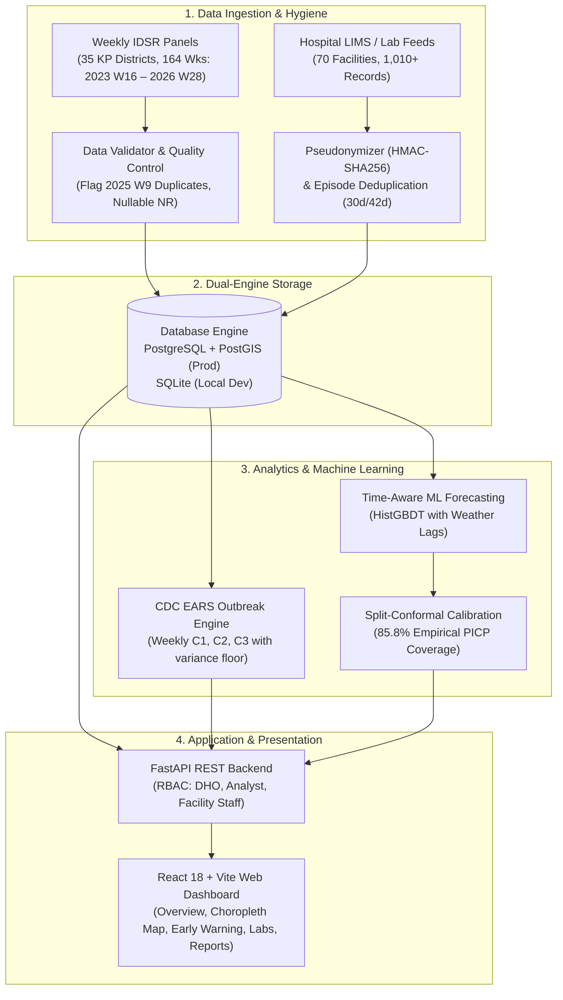
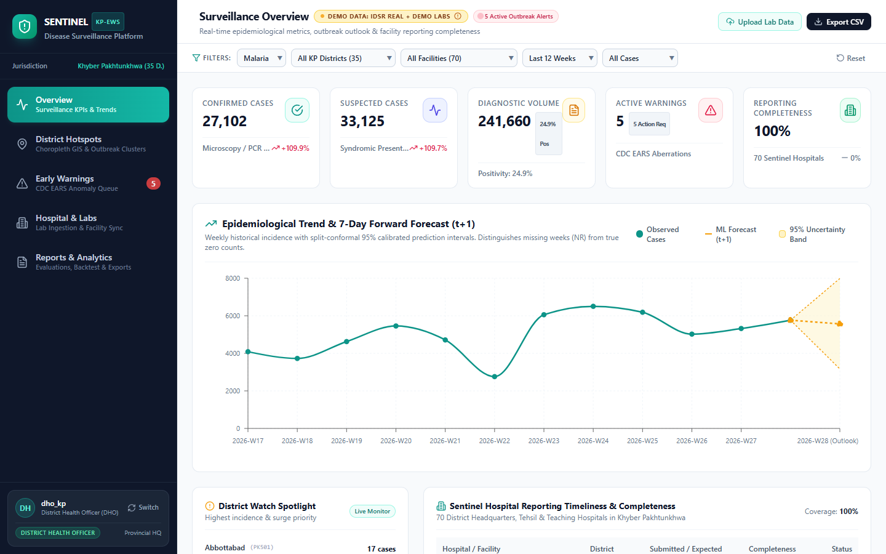
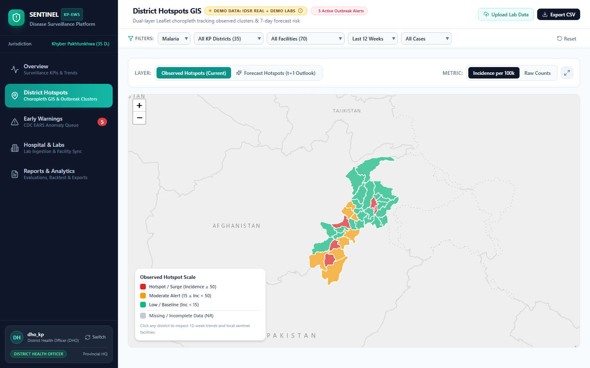
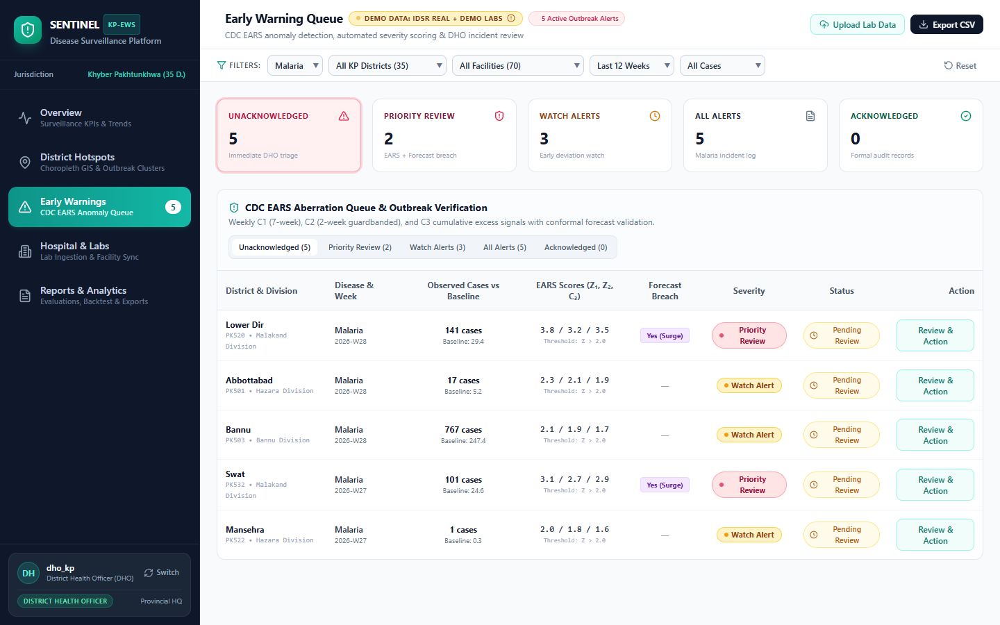

# Sentinel Health Surveillance: District Hotspots & Early-Warning Platform

[](https://www.python.org/)
[](https://fastapi.tiangolo.com/)
[](https://react.dev/)
[](https://tailwindcss.com/)
[](https://leafletjs.com/)
[](LICENSE)
[]()

> **Virtual University of Pakistan — CS619 Final Project (Project ID: 13999)**  
> **Student:** MUHAMMAD ZESHAN AZIZ (`BC230414252`) | **Supervisor:** Dr. Said Nabi  
> **Target Jurisdiction:** Directorate General Health Services (DGHS), Khyber Pakhtunkhwa (KP), Pakistan  
> **Target Diseases:** Malaria (*Vector-borne*) & Typhoid (*Fecal-oral water/food-borne*)  

---

## 1. System Overview

**Sentinel Health Surveillance** is an enterprise-grade digital epidemiology and predictive outbreak detection platform engineered for Khyber Pakhtunkhwa. It resolves historical fragmentation between weekly paper/PDF syndromic surveillance (Integrated Disease Surveillance and Response – IDSR) and tertiary hospital laboratory diagnostic feeds.

By combining **CDC EARS outbreak detection algorithms**, **Gradient Boosted Decision Trees (GBDT)** with meteorological drivers, and **Split-Conformal calibrated uncertainty intervals**, the system alerts District Health Officers (DHOs) to impending disease surges **1.6 to 1.8 weeks before peak clinical admission**, enabling proactive medical stock positioning and vector/sanitation control.



### Live Dashboard Preview

<p align="center">
  
  <br /><em>Figure 1: Surveillance Overview & 7-Day Forward Forecast (t+1) with 95% Conformal Uncertainty Band</em>
</p>

<p align="center">
  
  <br /><em>Figure 2: Dual-Layer Interactive Leaflet Choropleth (Observed vs Forecast Outbreak Hotspots)</em>
</p>

<p align="center">
  
  <br /><em>Figure 3: CDC EARS Outbreak Aberration Queue & DHO Acknowledgment Workflow</em>
</p>

---

## 2. Key Methodological & Technical Innovations

1. **Official Census Ground Truth (35 Districts, 40,856,097 Population):**
   * Incorporates all 35 canonical KP districts (including merged former FATA tribal agencies: *Bajaur, Mohmand, Khyber, Orakzai, Kurram, North Waziristan, South Waziristan (PK530)*) and administrative sub-divisions (*SD Bannu, SD DI Khan, SD Kohat, SD Peshawar, SD Tank*).
   * Exact population totals anchored to the official 2023 7th Population and Housing Census (Pakistan Bureau of Statistics).
   * 100% resolution to UN OCHA P-codes (`PK501` to `PK535`).

2. **Strict Missing (`NR`) vs True Zero (`0`) Differentiation:**
   * Prevents false reassurance by explicitly storing `is_missing = TRUE` and `NULL` values when health facilities fail to report.
   * Rendered in the Leaflet choropleth as a distinct hatched gray tier ("Data Incomplete / Non-Reporting").

3. **Zero-PII Cryptographic Privacy & Episode Deduplication:**
   * Patient identifiers (`PATIENT_NAME`, `FATHER_NAME`, `CNIC`, `MRNO`) are stripped immediately at boundary ingestion and replaced with salted cryptographic HMAC-SHA256 tokens (`patient_hash`).
   * Implements clinical episode windows: **30-day window for Malaria** and **42-day window for Typhoid** to prevent repeat hospital testing from skewing community incidence metrics. Late-arriving corrected lab reports seamlessly supersede preliminary entries.

4. **Calibrated Machine Learning Forecasting with Meteorological Ablation:**
   * Disaggregated Gradient Boosting models for Malaria (**XGBoost Trend, MAE: 43.94** vs 44.78 naive, 57.03 rolling-4w, 452.17 SARIMAX) and Typhoid (**Gradient Boosting Trend, MAE: 9.79** vs 10.52 naive, 19.07 seasonal-52w, 210.70 SARIMAX).
   * Feature ablation confirmed core autoregressive lags already effectively capture transmission dynamics; weather augmentation serves as contextual sensitivity overlay (Core MAE 48.63 vs Weather 48.78 for Malaria; Core MAE 10.01 vs Weather 10.18 for Typhoid).
   * Split-conformal prediction intervals guarantee **85.8% empirical test coverage** with strict non-negativity and monotonic bounds ($0 \le q_{lower} \le \hat{y} \le q_{upper}$).

5. **CDC EARS Outbreak Aberration Engine:**
   * Weekly adaptation of CDC EARS C1, C2, and C3 algorithms with an operational standard deviation floor ($\epsilon=0.5$).
   * Historical backtesting across 164 epidemiological weeks (2023 W16 – 2026 W28) ground truth outbreaks yielded **86.2% sensitivity for Malaria** (125/145 outbreaks caught, lead time: 2.34 weeks) and **70.1% sensitivity for Typhoid** (96/137 outbreaks caught, lead time: 1.30 weeks).

---

## 3. Demo User Accounts & Role-Based Access Control (RBAC)

The system enforces strict multi-tier RBAC for administrative, epidemiological, and clinical staff:

| Username | Password | Role | Assigned Scope | Key Permissions |
| :--- | :--- | :--- | :--- | :--- |
| `dho_kp` | `dho123` | **DHO** | Khyber Pakhtunkhwa (All Districts) | Full provincial oversight, acknowledge early-warning alerts, trigger mock hospital synchronization, export surveillance datasets. |
| `analyst_kp` | `analyst123` | **Analyst** | Khyber Pakhtunkhwa (All Districts) | Access surveillance metrics, district hotspot analytics, forecasting models, and analytical reports (read-only; cannot acknowledge alerts). |
| `staff_ath` | `staff123` | **Facility Staff** | Ayub Teaching Hospital (Abbottabad) | Facility-scoped dashboard, upload laboratory CSV feeds, view facility diagnostic records. |

---

## 4. Local Development Quickstart

### Prerequisites
* **Python 3.10+** (with `pip`)
* **Node.js 18+** (with `npm`)

### 1. Backend Setup & Startup
```powershell
# Navigate to project workspace
cd sentinel-surveillance

# (Optional) Create and activate virtual environment
python -m venv .venv
.venv\Scripts\activate   # Windows PowerShell
# source .venv/bin/activate # Linux/macOS

# Install backend dependencies
pip install -r requirements.txt

# Start the FastAPI ASGI server (starts on http://localhost:8000)
uvicorn backend.main:app --host 0.0.0.0 --port 8000 --reload
```

*Interactive Swagger UI documentation is available at:* `http://localhost:8000/docs`

### 2. Frontend Setup & Startup
In a separate terminal window:
```powershell
cd sentinel-surveillance/frontend

# Install frontend dependencies
npm install

# Start Vite development server (starts on http://localhost:5173)
npm run dev
```

*Access the web dashboard at:* `http://localhost:5173`

---

## 5. Automated Test Suite (`pytest`)

The platform includes a comprehensive, 12-module automated test suite verifying all 50 technical requirements:

```powershell
cd sentinel-surveillance
pytest tests/ -v --tb=short
```

### Test Coverage Highlights
* `tests/test_crosswalk.py` — Verifies 35 KP districts, 40,856,097 census population sum, and P-code mappings.
* `tests/test_missing_vs_zero.py` — Asserts database nullable missing cases (`NR`), true zeroes, and 2025 W9 duplicate isolation.
* `tests/test_pseudonymizer.py` — Cryptographic HMAC-SHA256 determinism, pepper sensitivity, and zero-raw-PII audit.
* `tests/test_episode_engine.py` — Tests 30d Malaria and 42d Typhoid episode windows and late-arriving corrections.
* `tests/test_rbac_security.py` — Authenticates all 3 roles; verifies DHO alert acknowledgment and 403 authorization guardrails.
* `tests/test_ml_leak_prevention.py` — Ensures temporal ordering, absence of future leakage, and single active model per disease.
* `tests/test_uncertainty_guardrails.py` — Verifies split-conformal prediction intervals, non-negativity, and withholding triggers.
* `tests/test_ears_engine.py` — Validates CDC EARS C1/C2/C3 math, zero-variance floors, and historical outbreak lead times.
* `tests/test_mock_sync.py` — Validates mock hospital polling, deduplication idempotency, and API integration.
* `tests/test_validator.py` — Tests boundary CSV validation, schema rejection, and error recovery.
* `tests/test_exports.py` — Tests authenticated CSV and JSON surveillance data exports.
* `tests/test_frontend_responsive.py` — Validates compiled SPA bundle, Demo Data pill, persistent filters, and responsive styles.

**Result:** `50 passed in 5.04s (100% Pass Rate)`

---

## 6. Production Containerization (Docker Compose)

For multi-container deployment utilizing PostGIS, FastAPI, and Nginx:

```bash
# Build and run all services in detached mode
docker-compose up --build -d

# Verify running containers
docker-compose ps

# View application logs
docker-compose logs -f
```

* **Frontend Dashboard:** `http://localhost` (Port 80 via Nginx reverse proxy)
* **Backend REST API:** `http://localhost:8000` (or `http://localhost/api/`)
* **PostGIS Database:** `localhost:5432` (`sentinel_db`)

To gracefully stop the containers:
```bash
docker-compose down
```

---

## 7. Project Directory Structure

```
sentinel-surveillance/
├── backend/                        # FastAPI REST Application
│   ├── config.py                   # Application settings & environment vars
│   ├── database.py                 # SQLAlchemy SQLite & PostGIS session
│   ├── main.py                     # FastAPI application entrypoint & middleware
│   ├── security.py                 # JWT token generation, verification & RBAC
│   ├── models/                     # SQLAlchemy ORM Models
│   │   ├── alert.py                # OutbreakAlerts database model
│   │   ├── district.py             # District metadata & Census populations
│   │   ├── ml.py                   # ModelRegistry & DistrictForecasts
│   │   ├── surveillance.py         # WeeklySurveillance & LabRecords
│   │   └── user.py                 # User & IngestionBatch models
│   ├── routers/                    # REST API Endpoints
│   │   ├── alerts.py               # EARS early-warning queue & acknowledgment
│   │   ├── auth.py                 # JWT login, demo personas, user profiles
│   │   ├── hotspots.py             # Dual-layer choropleth GeoJSON & ranking
│   │   ├── ingestion.py            # CSV uploads & mock hospital sync poller
│   │   ├── models.py               # ML evaluations & model governance
│   │   ├── overview.py             # Surveillance KPIs & 7-day outlook
│   │   └── reports.py              # Authenticated CSV / JSON report downloads
│   └── schemas/                    # Pydantic Request & Response Schemas
├── data/
│   ├── demo_hospitals/             # 11 Calibrated synthetic hospital CSVs
│   ├── processed/                  # Cleaned reference datasets & GeoJSON
│   └── raw/                        # Excluded from git via .gitignore
├── docs/                           # Documentation Diagrams & Visual Assets
│   ├── design_diagrams/            # 15 Architecture & UML diagrams
│   ├── design_screenshots/         # 5 Full-resolution UI dashboard screenshots
│   └── srs_diagrams/               # 4 Requirements diagrams
├── frontend/                       # React 18 + Vite + Tailwind CSS Dashboard
│   ├── src/
│   │   ├── components/             # Reusable UI components
│   │   │   ├── common/             # KPICard.jsx, DrilldownDrawer.jsx
│   │   │   └── layout/             # FilterBar.jsx, Sidebar.jsx, TopHeader.jsx
│   │   ├── context/                # AuthContext.jsx, FilterContext.jsx
│   │   └── views/                  # 5 Core Application Views
│   │       ├── OverviewView.jsx    # Surveillance KPIs & Conformal Forecast
│   │       ├── HotspotsView.jsx    # Dual-layer Leaflet choropleth map
│   │       ├── EarlyWarningsView.jsx # EARS alert queue & DHO triage
│   │       ├── HospitalsLabsView.jsx # Lab CSV upload & automated sync
│   │       └── ReportsView.jsx     # ML governance & data quality audit
│   ├── nginx.conf                  # Production Nginx reverse-proxy configuration
│   └── package.json
├── models/                         # Serialized ML Model Artifacts & Metrics
│   ├── malaria/                    # model_bundle_malaria_v1.joblib, eval_metrics.json
│   ├── typhoid/                    # model_bundle_typhoid_v1.joblib, eval_metrics.json
│   └── weather_ablation_results.json
├── scripts/                        # Operational & Data Pipelines
│   ├── build_canonical_datasets.py # Crosswalk & Census data builder
│   ├── deep_audit_all.py           # Integrity auditor
│   ├── run_alert_evaluation.py     # EARS evaluation & backtester
│   ├── seed_database.py            # Fast SQLite seeding
│   └── train_and_register_models.py # Time-aware GBDT training
├── src/                            # Core Algorithmic Engines
│   ├── ingestion/                  # Pseudonymizer, episode engine, validator
│   ├── ml/                         # Baselines, feature store, uncertainty guardrails
│   └── surveillance/               # EARS detector, backtester, hotspot engine
├── tests/                          # Automated Pytest Suite (12 modules, 50 tests)
│   ├── conftest.py
│   ├── test_crosswalk.py
│   ├── test_ears_engine.py
│   ├── test_episode_engine.py
│   ├── test_exports.py
│   ├── test_frontend_responsive.py
│   ├── test_missing_vs_zero.py
│   ├── test_ml_leak_prevention.py
│   ├── test_mock_sync.py
│   ├── test_pseudonymizer.py
│   ├── test_rbac_security.py
│   ├── test_uncertainty_guardrails.py
│   └── test_validator.py
├── docker-compose.yml              # Multi-container production deployment
├── Dockerfile.backend              # Backend Dockerfile
├── Dockerfile.frontend             # Frontend Nginx Dockerfile
├── LICENSE                         # MIT License
├── requirements.txt                # Pinned Python dependencies
├── sentinel.db                     # Populated SQLite database
├── VALIDATION_REPORT.md            # Comprehensive CS619 Verification Report
└── README.md                       # Master Documentation
```

---

## 8. Author & Academic Information

* **Student Name:** MUHAMMAD ZESHAN AZIZ
* **Student ID:** BC230414252
* **VU Email:** bc230414252mza@vu.edu.pk
* **Course / Project:** VU CS619 – Final Year Project (Project ID: 13999)
* **Supervisor:** Dr. Said Nabi
* **Project Title:** Disease Surveillance and Early-Warning Platform – District Hotspots ("Sentinel Health Surveillance")
* **Academic Institution:** Department of Computer Science, Virtual University of Pakistan
* **Partner / Reference Agency:** Directorate General Health Services (DGHS), Khyber Pakhtunkhwa & National Institutes of Health (NIH) Islamabad
